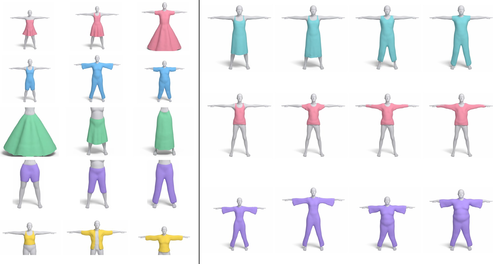
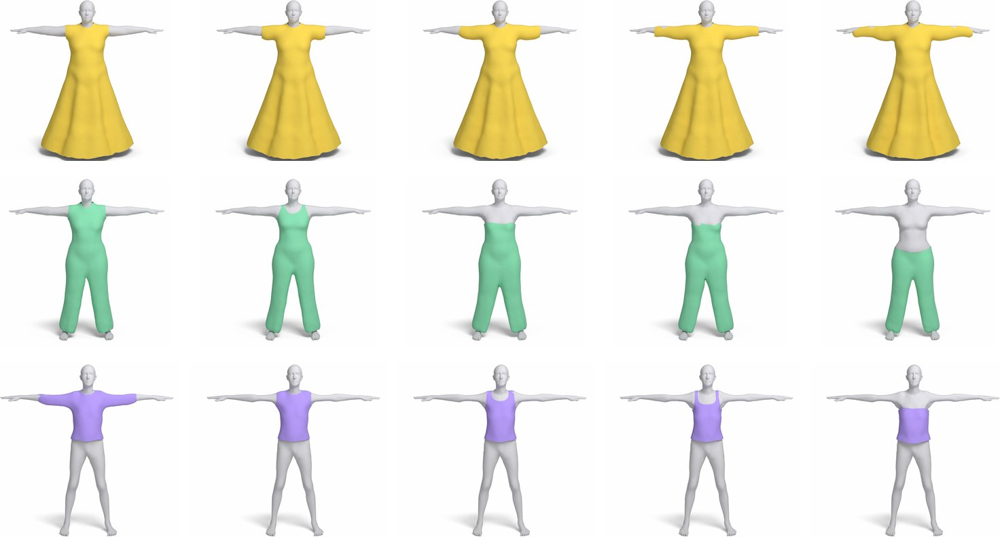
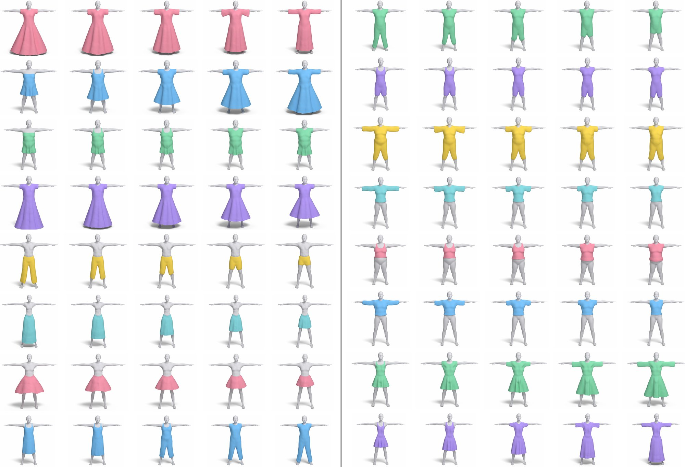

# TailorFlow: A Unified and Expressive Generative Model for 3D Clothing

[Project page](https://cdxpb.github.io/TailorFlow)



TailorFlow is a generative model for 3D garments of every topology: dresses, jumpsuits, skirts, trousers and tops.
It generates clothing for any body shape, and garments can be edited by painting where they should cover the body.

## Installation

```bash
git clone https://github.com/cdxpb/TailorFlow.git
cd TailorFlow
conda env create -f environment.yml
source env.sh
```

The environment uses Python 3.10, PyTorch 2.4.1 with CUDA 12.4, and PyTorch3D 0.7.7. It includes its own `nvcc`, so the
CUDA extensions in `tailorflow/third_party/` compile on first use. An NVIDIA driver >= 550 is required.

Run all commands from the repository root.

## Pretrained models

Download both checkpoints from [Google Drive](https://drive.google.com/drive/folders/184jAxAquFmAc5pdTAENSfgBwG-UyAl4Z?usp=sharing)
and place them next to the configs that ship with this repository:

```
checkpoints/
  vae/    config.json  ckpt_020000.pt             (vae_ckpt_020000.pt)
  prior/  config.json  stats.pt  ckpt_020000.pt   (prior_ckpt_020000.pt)
```

```bash
pip install gdown
gdown --folder https://drive.google.com/drive/folders/184jAxAquFmAc5pdTAENSfgBwG-UyAl4Z -O checkpoints/download
mv checkpoints/download/vae_ckpt_020000.pt   checkpoints/vae/ckpt_020000.pt
mv checkpoints/download/prior_ckpt_020000.pt checkpoints/prior/ckpt_020000.pt
```

All scripts and the demo use these paths by default.

## Data

The demo needs only the SMPL body model; generation, evaluation and training also need CLOTH3D. Both require registration.
Download them and place them as shown:

| Data | Source | Location |
|---|---|---|
| SMPL | <https://smpl.is.tue.mpg.de> | `data/smpl/SMPL_{FEMALE,MALE}.pkl` |
| CLOTH3D | <https://cloth3d.is.tue.mpg.de> | `data/C3D_RAW/{train,val_t1,test_t1}.tar.gz` |

Every use needs the SMPL triangles and body-part labels, written from the SMPL files by

```bash
python tailorflow/preprocessing/smpl_assets.py
```

That is all the demo needs. For the other scripts, build the CLOTH3D dataset:

```bash
python tailorflow/preprocessing/fetch.py         # checks that the downloads are in place
bash   tailorflow/preprocessing/extract.sh
python tailorflow/preprocessing/build.py
```

See [tailorflow/preprocessing/README.md](tailorflow/preprocessing/README.md) for details.

## Interactive demo



```bash
python tailorflow/viz/server.py --port 8000
```

Open <http://localhost:8000> to sample garments, paint their coverage to grow or trim them, and change the body.
On a remote machine, forward the port first: `ssh -L 8000:localhost:8000 <host>`. Random bodies and coverages are drawn
from train-set statistics shipped in `tailorflow/viz/body_stats.npz`. See [tailorflow/viz/README.md](tailorflow/viz/README.md).

## Generation

```bash
python tailorflow/run_pipeline.py
```

This samples garments of each class on held-out bodies and writes point clouds, meshes and renders to
`checkpoints/prior/`.

## Interpolation



```python
from tailorflow.interp import interpolate
frames = interpolate(prior, vae, cl, bv, zg_a, lat_a, zg_b, lat_b, alphas=np.linspace(0, 1, 5))
```

Each frame is a `(zg, lat)` pair that can be decoded with `vae.decode` on any body. `tailorflow/render.py` renders a row
of garments with Mitsuba 3 (GPU with compute capability 7.5 or newer).

## Evaluation

```bash
python tailorflow/eval_prior.py    # 1-NNA, COV, MMD, JSD and body intersection
python tailorflow/eval_recon.py    # reconstruction error
```

## Training

```bash
# VAE
torchrun --standalone --nproc_per_node 1 tailorflow/train_vae.py --exp my_vae

# Prior, stage 1
torchrun --standalone --nproc_per_node 1 tailorflow/train_prior.py --exp my_prior_stage1 \
  --vae checkpoints/my_vae/ckpt_020000.pt

# Prior, stage 2 (adds inpainting for coverage editing)
torchrun --standalone --nproc_per_node 1 tailorflow/train_prior.py --exp my_prior \
  --vae checkpoints/my_vae/ckpt_020000.pt --init my_prior_stage1 --init_ckpt ckpt_040000.pt \
  --steps 20000 --lr 3e-5 --inpaint_p 0.5 --val 0 --ckpt_keep_after 0 --ckpt_keep_every 2000
```

The defaults are the settings of the released models. `--bs` is the batch size per GPU. Checkpoints and logs are written
to `checkpoints/<exp>/`; pass `--prior_exp my_prior` to the generation and evaluation scripts to use your own model.

## Acknowledgements

We thank the authors of the following works for releasing their code and models:
[LION](https://github.com/nv-tlabs/LION), [Rectified Flow](https://github.com/gnobitab/RectifiedFlow),
[JiT](https://github.com/LTH14/JiT), [PVCNN](https://github.com/mit-han-lab/pvcnn), [PVD](https://github.com/alexzhou907/PVD),
[PointFlow](https://github.com/stevenygd/PointFlow), [Screened Poisson Surface Reconstruction](https://github.com/mkazhdan/PoissonRecon),
[PyTorch3D](https://github.com/facebookresearch/pytorch3d), [ChamferDistancePytorch](https://github.com/ThibaultGROUEIX/ChamferDistancePytorch),
[PyTorchEMD](https://github.com/daerduoCarey/PyTorchEMD), [Mitsuba 3](https://github.com/mitsuba-renderer/mitsuba3) and
[three.js](https://github.com/mrdoob/three.js).
We use the [CLOTH3D](https://cloth3d.is.tue.mpg.de) dataset and the [SMPL](https://smpl.is.tue.mpg.de) body model, and compare
against [SMPLicit](https://github.com/enriccorona/SMPLicit), [ISP](https://github.com/liren2515/ISP),
[DrapeNet](https://github.com/liren2515/DrapeNet), [DIG](https://github.com/liren2515/DIG) and
[Neural-ABC](https://github.com/USTC3DV/NeuralABC-code).

## License

CLOTH3D and SMPL are distributed under their own licenses, which you accept when downloading them. Files derived from
SMPL are not included in this repository; `tailorflow/preprocessing/smpl_assets.py` generates them locally.
`tailorflow/third_party/chamfer3d` and `tailorflow/third_party/emd` come from ChamferDistancePytorch and PyTorchEMD and keep
their MIT licenses.
